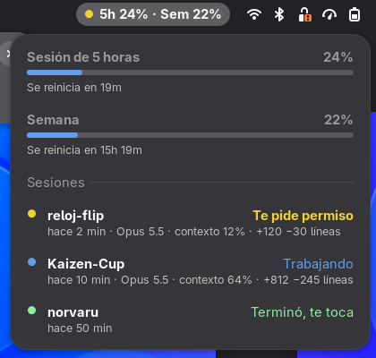
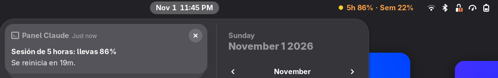

# Panel Claude

Extensión de GNOME que pone en la barra de arriba lo que pasa en Claude Code: cuánto llevas de tus
límites (la sesión de 5 horas y la semana), qué está haciendo cada sesión abierta y un aviso cuando
una termina o te pide permiso, aunque tengas la terminal escondida.

Es un proyecto independiente, sin relación con Anthropic.





## Qué hace
- **En la barra:** `5h 24% · Sem 22%`, con un punto de color según la sesión más urgente:
  amarillo si alguna te espera, azul si alguna trabaja, verde si alguna terminó.
  El texto se pone naranja a partir del 80 % y rojo a partir del 95 %.
- **Al hacer clic:**
  - Cada límite con su barra y cuándo se reinicia.
  - Cada sesión abierta: proyecto, qué hace (trabajando, te pide permiso, te hizo una pregunta,
    terminó), desde cuándo, modelo, cuánto contexto lleva y líneas agregadas y quitadas.
  - Clic en una sesión: te lleva a la ventana de la terminal donde está.
- **Avisos de GNOME:**
  - Una sesión te pide permiso o te hace una pregunta.
  - Una sesión terminó después de trabajar 20 segundos o más (las respuestas rápidas no avisan).
  - Un límite pasa del 80 % y del 95 % (una vez por periodo).
- Las sesiones cerradas desaparecen solas.

## Cómo funciona
Claude Code no tiene una forma directa de decirle a GNOME qué hace, así que hay dos piezas:

| Pieza | Qué hace |
|---|---|
| `reportero/reportero.py` | Claude Code lo llama desde sus *hooks* (avisos que dispara en cada paso: empezó, usó una herramienta, terminó, pide permiso) y desde la barra de estado (cada pocos segundos, con modelo, contexto y límites). Escribe un archivo pequeño por sesión en `$XDG_RUNTIME_DIR/panel-claude/`. Si algo falla, se calla para no estorbar a Claude Code. |
| `extension/` | La extensión de GNOME Shell. Vigila esa carpeta y pinta la barra, el menú y los avisos. |

Los límites solo los conoce la barra de estado de Claude Code, por eso el reportero también se
engancha ahí. Nada sale de tu computadora.

## Instalar
Requisitos: GNOME 48 a 51, Python 3.10 o más nuevo y Claude Code.

```bash
git clone https://github.com/DimitriMedNov/panel-claude.git
cd panel-claude
./install.sh
```

`install.sh` no pide sudo. Copia la extensión a `~/.local/share/gnome-shell/extensions/`, el reportero
a `~/.local/share/panel-claude/` y agrega los hooks a `~/.claude/settings.json` (guarda una copia del
original en `settings.json.antes-de-panel-claude`).

Falta un paso a mano, para los límites:
- **Si no tienes barra de estado propia en Claude Code**, agrega esto a `~/.claude/settings.json`:
  ```json
  "statusLine": {"type": "command", "command": "python3 -I ~/.local/share/panel-claude/reportero.py uso", "refreshInterval": 5}
  ```
- **Si ya tienes un script de barra de estado**, agrégale esta línea justo después de leer la
  entrada en `$input`:
  ```bash
  printf '%s' "$input" | python3 -I ~/.local/share/panel-claude/reportero.py uso
  ```

Después cierra sesión y vuelve a entrar para que GNOME cargue la extensión. Las sesiones de Claude
Code que ya estaban abiertas aparecen en cuanto hagan algo.

Para quitarlo: `./install.sh --quitar`.

## Problemas comunes
- **El panel dice "Aún no hay datos".** Falta el paso de la barra de estado, o todavía no has
  abierto Claude Code desde que instalaste.
- **Una sesión no aparece.** Las sesiones abiertas antes de instalar no tienen los hooks: ciérrala
  y ábrela de nuevo.
- **Ver qué recibe el panel:** `ls $XDG_RUNTIME_DIR/panel-claude/`.

## Licencia
[MIT](LICENSE).
